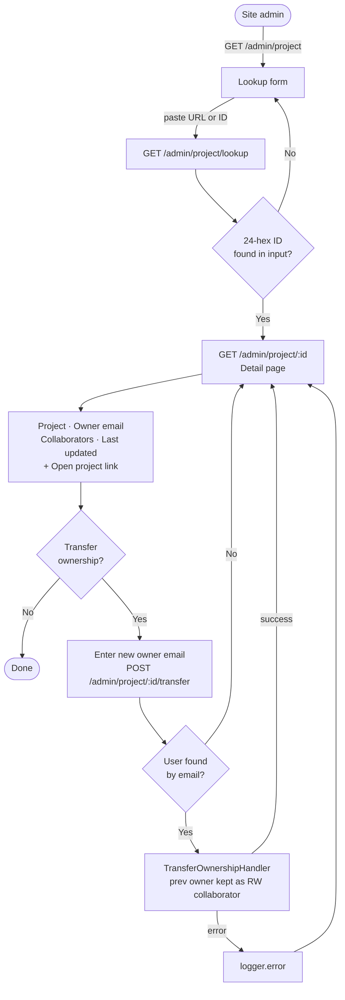

# Admin Project Management

Look up any project by URL or ID, view its details, and transfer ownership
to another user. Admin-only, disabled by default — adds nothing to stock
Overleaf CE until you turn it on.

## What it does

- **Look up** a project by pasting a project URL or a bare 24-char ID.
- **View** project name, ID, owner email, collaborator count, last-updated,
  with a link to open the project.
- **Transfer ownership** to a new owner by email. The previous owner stays on
  as a read-and-write collaborator; the new owner need not already be one.

No project create / delete / archive / settings editing here — those live in
other admin panels.

## Upstream CE comparison

Upstream CE provides limited admin functionality and does not include this project lookup and ownership-transfer page. This module adds those tools behind `ADMIN_PROJECT_MANAGEMENT_ENABLED`; the official [Server Pro vs. Community Edition comparison](https://docs.overleaf.com/on-premises/welcome/server-pro-vs.-community-edition) outlines the broader product differences. This is a CE extension, not Server Pro.

## Configuration

Two env vars, both must be `true` for the module to appear and work:

| Env var                            | Effect                                                             | Default |
| ---------------------------------- | ------------------------------------------------------------------ | ------- |
| `ADMIN_PRIVILEGE_AVAILABLE`        | Master switch for all admin features; off = nobody is a site admin | `false` |
| `ADMIN_PROJECT_MANAGEMENT_ENABLED` | Enables this module (routes + nav link)                            | `false` |

```env
ADMIN_PRIVILEGE_AVAILABLE=true
ADMIN_PROJECT_MANAGEMENT_ENABLED=true
```

The acting user must also have `isAdmin: true` (e.g. set via `bin/admin`).

## User guide



### Detail page fields

| Field         | Source                       |
| ------------- | ---------------------------- |
| Project name  | project document             |
| Project ID    | `_id`, shown in a code block |
| Owner         | owner's email                |
| Collaborators | count, excluding the owner   |
| Last updated  | `lastUpdated`                |

### Transfer feedback messages

| Outcome       | Message                                                     |
| ------------- | ----------------------------------------------------------- |
| empty email   | Please enter the new owner's email address.                 |
| no user match | No user was found with that email address.                  |
| success       | Ownership transferred successfully.                         |
| failure       | Ownership transfer failed. See the server logs for details. |

The transfer is the only data-changing action and is **rate-limited**:
30 requests / 60s per admin.

## Developer design

The module entry registers a feature-gated router. Server-rendered Pug pages
call its controller, which reuses `ProjectGetter`, `UserGetter`, and
`CollaboratorsGetter` for lookup, and `OwnershipTransferHandler` for transfers.
The transfer carries the acting admin's user ID and IP for audit logging.

**MongoDB:** No collections are added. Lookup reads existing `projects` and
`users`; transfer updates ownership and collaborators through the core handler
and records the action in `projectAuditLogEntries`.

**Access:** No role is added. Routes require the module flag, enabled site-admin
privileges, and `isAdmin: true`. Transfer requests also require CSRF validation
and the 30-per-minute rate limit. The module adds no project ACL or session
store.
