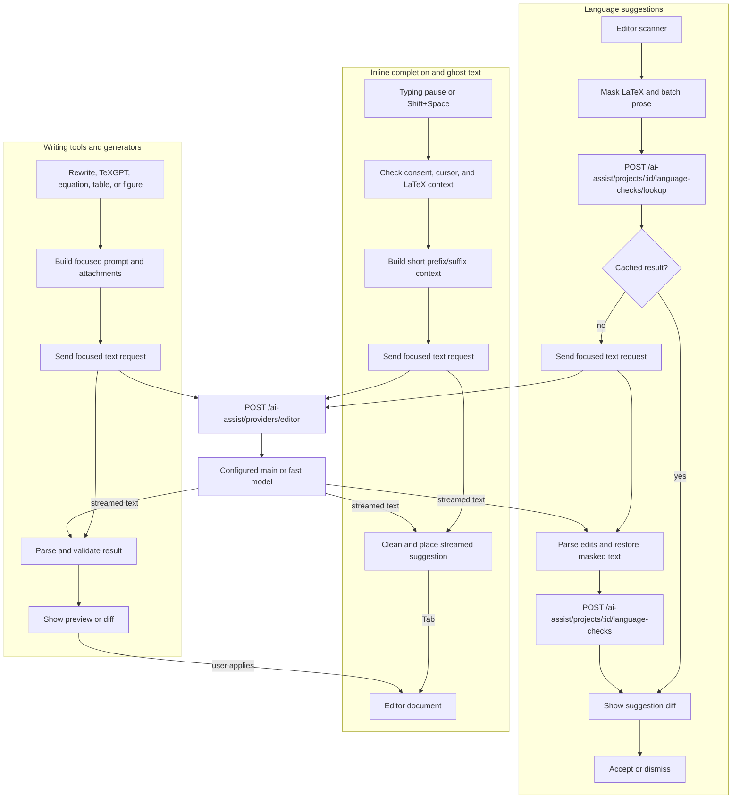

# AI Assist Module (`ai-assist`)

AI Assist adds an in-editor assistant and writing tools for Overleaf projects. It is off by default. Users supply their own language-model providers in **Account Settings → AI Features**; server-side model API keys are not required.

## Upstream CE comparison

Upstream Overleaf CE provides the LaTeX editor and project collaboration, but does not include this AI Assist module. This module adds model-powered chat, project tools, PDF analysis, writing aids, and optional web research to self-hosted CE. See the [upstream Overleaf repository](https://github.com/overleaf/overleaf).

## How it works

```text
User request → relevant project/PDF context → configured model → tools or answer → approval when needed → saved chat and checkpoint
```

The assistant uses the current selection, cursor, open file, compile state, PDF view, and project structure when relevant. It reads additional files through tools instead of sending the whole project by default. Tool results become context for the next model response. Changes are applied to the project according to the selected mode.

### Modes

| Mode             | What happens                                                                                                                          |
| :--------------- | :------------------------------------------------------------------------------------------------------------------------------------ |
| **Manual**       | Ask before each file edit, file creation, or settings change. Read-only actions run directly.                                         |
| **Accept Edits** | Apply file edits, file creation, and project compiler settings directly. Account-level preferences still ask first.                   |
| **Plan**         | Research and present a plan. Editing and settings tools are unavailable until the user approves a plan and continues in another mode. |

## Features

### Chat, project context, and authoring

The assistant can inspect a project outline and included files, packages, labels and citations; list, read, search, edit, and create project files; compile and inspect compile output; and review or change compiler, editor, and appearance settings. Project-specific instructions can be placed in a root-level `AGENTS.md`; these are read at the start of each run.

Slash commands provide focused prompts: `/fix`, `/layout`, `/preamble`, `/rewrite`, `/proofread`, `/translate`, `/cite`, `/bib`, `/table`, `/figure`, `/equation`, `/explain`, `/summarize`, `/review`, and `/check`.

### Compiled PDF tools

The assistant can view a PDF page or overview, search rendered text, map a page element back to source, compare the latest two builds, inspect typography and layout, and move the user's PDF viewer to highlighted source. PDF tools are read-only and available in every mode. The current PDF view and selected text or region can also provide context to a chat turn.

### Inline writing tools

- **Completion and ghost text:** suggest LaTeX at the cursor, manually or after a typing pause; accept suggestions with Tab.
- **Language suggestions and writing tools:** review grammar, rephrase, shorten, lengthen, change style, split or join text, translate, or suggest synonyms. Preview and apply edits while preserving LaTeX structure.
- **TeXGPT:** generate titles, abstracts, or keywords in document environments.
- **Equation, table, and figure generators:** create LaTeX from descriptions or supported image inputs.
- **Empty-line prompt:** type a natural-language request on an empty line to generate at the cursor.
- **Suggest Fix:** investigate compile errors or warnings and propose a fix for approval.
- **Quick actions and starters:** offer prompts based on selected content, project structure, and compile state.
- **Edit glow:** highlight and scroll to recently applied AI changes.

These features use the user's configured main or fast model. Their per-user preferences are in **Account Settings → AI Features**.

### Web research and external tools

When web tools are enabled, `web_search` returns cited results and `web_fetch` reads pages, PDFs, and text. An optional browser sidecar can render JavaScript-heavy pages. Users can also connect external MCP servers in **Account Settings → AI Features → Connectors**; the assistant can call their tools when enabled for the chat. Connector setup supports OAuth, API-key headers, configuration import, and per-chat tool controls.

### Chats, background work, and recovery

Chats are saved and can be reopened from chat history. Runs continue if the user switches chats or closes the tab. Each assistant turn that changes project files creates a checkpoint. Users can rewind code, rewind the conversation, reset the conversation while keeping code, or fork a chat; the rewind view shows the proposed file differences.

## Developer architecture

AI Assist has two execution paths. The main chat runs as a resumable server-side job; focused tasks such as **Suggest Fix** run in the editor page. Inline writing features make short, text-only model requests. All provider traffic is relayed by Overleaf, so the browser does not call model endpoints directly.

### Agent workflows: chat and Suggest Fix

```mermaid
flowchart TD
  subgraph ChatFlow[Main chat: resumable server run]
    Chat[Chat panel] -->|POST /ai-assist/projects/:id/runs| RunAPI[Run API]
    RunAPI --> Manager[Background run manager]
    Manager --> ModelA[Configured model]
    ModelA -->|tool calls| ProjectTools[Project, PDF, web, and MCP tools]
    ProjectTools -->|tool results| Manager
    Manager -->|GET /ai-assist/projects/:id/runs/:runId/stream| Events[Resumable event stream]
    Events --> Chat
    Chat -->|POST .../:runId/approve or /compile| ControlAPI[Run control API]
    ControlAPI --> Manager
  end

  subgraph FixFlow[Suggest Fix: focused in-page run]
    Log[Compile log: Suggest Fix] --> Context[Focused log, source, and preamble]
    Context --> FixAgent[In-page agent loop]
    FixAgent -->|POST /ai-assist/providers/chat| RelayChat[Provider chat relay]
    RelayChat --> ModelB[Configured model]
    ModelB -->|tool calls| FixAgent
    FixAgent -->|read project; propose edit| Review[Diff and user decision]
    Review -->|accepted or rejected result| FixAgent
    FixAgent -. optional web_search / web_fetch .-> WebAPI[Web tools API]
    WebAPI --> FixAgent
  end
```



### Inline editor workflows



### What each request path does

| Path                     | API and owner                                                                                                                                                                        | Response and next step                                                                                                                                                                   |
| :----------------------- | :----------------------------------------------------------------------------------------------------------------------------------------------------------------------------------- | :--------------------------------------------------------------------------------------------------------------------------------------------------------------------------------------- |
| **Main chat**            | `POST /ai-assist/projects/:Project_id/runs`; the run manager calls the configured provider. The editor follows `GET .../runs/:runId/stream`.                                         | Streams assistant text, tool activity, approval requests, and compile requests. The editor performs compile requests and reports results; the user approves edits according to the mode. |
| **Suggest Fix**          | The editor builds a focused transcript from the selected log entry, nearby source, preamble, and other compile diagnostics. The in-page agent uses `POST /ai-assist/providers/chat`. | Read-only project tools investigate the cause; `edit_file` returns a diff for the user to accept or reject. Optional research uses the project web-tools API.                            |
| **Inline text**          | `POST /ai-assist/providers/editor`, used by completion, language checks, writing tools, and generators. This relay accepts text-only model requests without agent tools.             | Streams text to feature-specific parsers. Each feature validates, cleans, or masks the result before showing ghost text, a diff, or a generator preview.                                 |
| **Language-check cache** | `POST /ai-assist/projects/:Project_id/language-checks/lookup` and `POST .../language-checks`.                                                                                        | Reuses checked sentence edits across project collaborators; cache misses call the inline text path. Dismissals remain local to each author.                                              |

The editor applies model output only through the feature's UI: chat mode gates agent tools, Suggest Fix presents a diff, and inline tools present a suggestion or preview. The provider relay handles credentials, streaming, retry behavior, and provider-specific request formats; feature code owns context selection and result parsing.

### Code map

- `frontend/js/features/ai-assist/agent/`: chat context, tool loop, modes, approvals, background-run client, and fix workflow.
- `frontend/js/features/ai-assist/providers/`: provider types, settings, and streaming clients for the chat and text-only APIs.
- `frontend/js/features/ai-assist/{completion,language-suggestions,writing-tools,texgpt,equation,table,generator}/`: editor feature workflows and result handling.
- `app/src/AiAssistRunRouter.mjs`: API routes; `AiAssistRunManager.mjs` owns background chat runs; `AiAssistProviderController.mjs` relays individual provider calls.
- `app/src/AiAssistTools.mjs` and `app/src/connectors/`: agent tool behavior and external MCP connectors.
- `app/src/AiAssistChatHistoryStore.mjs`, `AiAssistCheckpointStore.mjs`, and `AiAssistLanguageCheckStore.mjs`: local-file persistence for chats, rewind snapshots, and shared language-check results.

## Configuration

Set these in `variable.env` (or the environment for the `overleaf` service). Restart the service after changing them.

| Environment variable                       | Default | Purpose                                                                                                                                            |
| :----------------------------------------- | :------ | :------------------------------------------------------------------------------------------------------------------------------------------------- |
| `AI_ASSIST_ENABLED`                        | `false` | Enables the module and its editor features.                                                                                                        |
| `AI_ASSIST_REQUEST_TIMEOUT_SECONDS`        | `180`   | Maximum wait for a model's first response.                                                                                                         |
| `DOCKER_HOST_GATEWAY`                      | auto    | Docker host address for reaching a model at `localhost` from the Overleaf container; set it for host networking or Podman if auto-detection fails. |
| `AI_ASSIST_WEB_TOOLS_ENABLED`              | `false` | Enables web search and fetch. Provider settings below supply server-side search.                                                                   |
| `AI_ASSIST_SEARXNG_URLS`                   | —       | Comma-separated SearXNG instance URLs.                                                                                                             |
| `AI_ASSIST_TAVILY_API_KEYS`                | —       | Tavily search keys.                                                                                                                                |
| `AI_ASSIST_EXA_API_KEYS`                   | —       | Exa search keys.                                                                                                                                   |
| `AI_ASSIST_JINA_API_KEYS`                  | —       | Jina search keys.                                                                                                                                  |
| `AI_ASSIST_FIRECRAWL_API_KEYS`             | —       | Firecrawl cloud keys.                                                                                                                              |
| `AI_ASSIST_FIRECRAWL_SELFHOSTED_URLS`      | —       | Self-hosted Firecrawl URLs.                                                                                                                        |
| `AI_ASSIST_LANGSEARCH_API_KEYS`            | —       | LangSearch keys.                                                                                                                                   |
| `AI_ASSIST_OLLAMA_API_KEYS`                | —       | Ollama web-search keys.                                                                                                                            |
| `AI_ASSIST_WEBSEARCHAPI_API_KEYS`          | —       | WebSearchAPI keys.                                                                                                                                 |
| `AI_ASSIST_TINYFISH_API_KEYS`              | —       | TinyFish keys.                                                                                                                                     |
| `AI_ASSIST_PARALLEL_API_KEYS`              | —       | Parallel keys.                                                                                                                                     |
| `AI_ASSIST_MCP_URLS`                       | —       | Custom web-search endpoints using `POST {"q":"…"}` and returning `{"results":[…]}`.                                                                |
| `AI_ASSIST_MCP_HEADERS`                    | —       | Headers for custom web-search endpoints. Accepts a JSON object/array or `Key: Value` lines.                                                        |
| `AI_ASSIST_MCP_BEARER_TOKEN`               | —       | Bearer token for custom web-search endpoints; used unless an Authorization header is supplied.                                                     |
| `AI_ASSIST_WEB_SEARCH_CACHE_HOURS`         | `24`    | Cache lifetime for searches and fetched pages; `0` disables caching.                                                                               |
| `AI_ASSIST_WEB_SEARCH_MAX_CACHED_SEARCHES` | `256`   | Maximum cached search results.                                                                                                                     |
| `AI_ASSIST_WEB_SEARCH_MAX_CACHED_PAGES`    | `64`    | Maximum cached pages.                                                                                                                              |
| `AI_ASSIST_BROWSER_URL`                    | —       | URL of the optional `overleaf-browser` service, e.g. `http://overleaf-browser:3000`.                                                               |
| `AI_ASSIST_BROWSER_TOKEN`                  | —       | Shared token for `overleaf` and `overleaf-browser`; set the same value as `BROWSER_TOKEN`.                                                         |

Search keys and URLs can be comma-separated. Setting any server search key or URL makes that provider available to all users; users can also configure personal search providers in AI Features settings. Server search requires both `AI_ASSIST_ENABLED=true` and `AI_ASSIST_WEB_TOOLS_ENABLED=true`.

For the optional `overleaf-browser` service, configure its container environment:

| Environment variable | Default | Purpose                                                       |
| :------------------- | :------ | :------------------------------------------------------------ |
| `BROWSER_TOKEN`      | —       | Required shared authentication token (32 or more characters). |
| `BROWSER_CAPACITY`   | `2`     | Number of pages rendered at once.                             |
| `BROWSER_LANG`       | `en-US` | Browser language.                                             |
| `UPSTREAM_PROXY`     | —       | Optional outbound proxy URL.                                  |

The `overleaf-browser` service and its `./data/browser-profile` volume are commented out by default in `docker-compose.yaml`. Uncomment them before using the profile, then start the sidecar with `docker compose --profile overleaf-browser up -d` after configuring the same token on both services.

## Providers and user settings

In **Account Settings → AI Features**, each user can configure a main model and an optional fast model for lightweight writing tasks. Supported model families are **OpenAI**, **Anthropic**, **Google Gemini**, and **Ollama**, including compatible endpoints where supported. Users set the provider, model, optional base URL, API key, context window, and output limit. They can also set reasoning/thinking preferences, inline feature behavior, personal web-search providers, and MCP connectors.

Provider API keys and connector credentials are encrypted in MongoDB using the Overleaf session secret. Keep the session secret stable (or retain its configured rotation fallbacks) to preserve access to saved credentials. Server-configured web-search credentials come from the environment and are not user model-provider credentials.

## Data and persistence

### MongoDB collections

| Collection                     | One record represents         | Purpose                                                                                 |
| :----------------------------- | :---------------------------- | :-------------------------------------------------------------------------------------- |
| `aiAssistUserSettings`         | One Overleaf user             | Main/fast model settings, encrypted provider keys, and personal web-search settings.    |
| `aiAssistConnectors`           | One user's MCP connector      | Endpoint, discovered tools, enabled-tool permissions, and connector status.             |
| `aiAssistConnectorCredentials` | One connector's secret bundle | Encrypted API-key headers and OAuth credentials, kept separate from connector metadata. |
| `aiAssistOAuthClients`         | One issuer and callback pair  | OAuth client registration reused for connector authorization.                           |
| `aiAssistOAuthStates`          | One in-flight OAuth sign-in   | Short-lived state and encrypted verifier; expired records are removed by a TTL index.   |

AI Assist creates no Overleaf project role. Existing account and project permissions authorize access; **Manual**, **Accept Edits**, and **Plan** are per-run tool policies, not roles. Indexes are ensured when the enabled module starts; there are no AI Assist data migrations.

### Files and run state

| Data                              | Stored where                                        | What it contains                                                                 |
| :-------------------------------- | :-------------------------------------------------- | :------------------------------------------------------------------------------- |
| Chats and per-user AI preferences | `/var/lib/overleaf/data/ai-assist`                  | Chat transcripts, titles, composer and feature preferences.                      |
| Checkpoints                       | `/var/lib/overleaf/data/ai-assist/checkpoints`      | Per-turn project file snapshots used for rewind and fork.                        |
| Language-check results            | `/var/lib/overleaf/data/ai-assist/language-checks`  | Project-shared suggestion cache; individual dismissals remain local.             |
| Web cache                         | `/var/lib/overleaf/data/ai-assist/web-cache.sqlite` | Cached search results and fetched pages; rebuildable.                            |
| Active run status and events      | Redis                                               | Reconnectable run state; expires after up to 7 days and is not the chat archive. |

Back up the Overleaf data volume and MongoDB to retain chat history, checkpoints, user configuration, and connectors. Preserve the Overleaf session secret so encrypted credentials remain readable. The model provider receives the prompt, selected context, and tool results needed for the request; configure user-selected providers according to your data policies.
