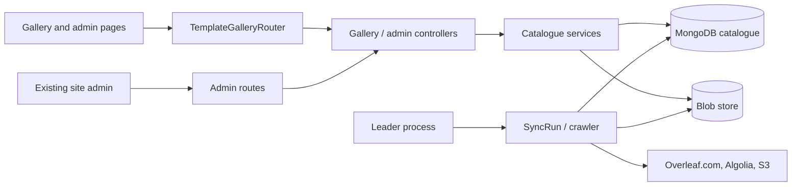

# Template Gallery Module (`template-gallery`)

A mirror of the overleaf.com template gallery. It fetches the same catalogue,
detail pages, previews and PDFs as overleaf.com, keeps them in its own Docker
volume (`template-gallery`, mounted at `/var/lib/template-gallery`), and serves them from there for faster use.
There are no custom or uploaded templates, no review or publish workflow, and no per-item metadata
editing.

## Upstream CE comparison

The upstream CE project/template flow does not include this local mirror of
the overleaf.com public gallery. This module adds the mirrored catalogue,
cached detail pages and files, and its own sync controls. The normal CE project
creation flow continues to work when the module is disabled.

## Activation

The feature gate is off by default.

```env
TEMPLATE_GALLERY_ENABLED=true
# Optional: requests a minute to overleaf.com per outbound route (1-120)
TEMPLATE_GALLERY_FETCH_RPM=30
```

`TEMPLATE_GALLERY_FETCH_RPM` caps how often each outbound route (the direct
connection and each proxy) starts a request to overleaf.com. The sync fetches in
parallel, but starts stay at least `60 / rpm` seconds apart, and the budget is
shared with users opening gallery pages. The default, 30, is half the one
request a second overleaf.com is seen to accept. On a 403/429 the route slows
down and backs off on its own. Raise the value only with a proxy pool behind
you; adding proxies is the better way to sync faster.

Everything else is fixed in `app/src/TemplateGalleryDefaults.mjs`. Admins set
the rest through the admin API under `/admin/templates/api`:

- **Sync settings** (`settings`): `autoSync` (off by default; when on, a sync
  runs every `refetchDays` days) and `refetchDays` (default 7, range 1-365).
  Nothing is fetched from overleaf.com unless a sync is started or auto sync is on.
- **Egress proxies** (`egress`): optional HTTP, HTTPS, SOCKS5 or SOCKS5H proxies
  for requests to overleaf.com, Algolia and S3. With none configured, requests
  go direct. Only the gallery uses them; the rest of Overleaf is unaffected.
  Proxy logins are sealed with the session key and never returned.
- **Session cookie** (`credentials/session`): the overleaf.com session cookie,
  which lets "Open as template" fetch complete projects.

## What the mirror does

- **Sync runs:** started by an admin ("Sync now") or by auto sync. Only the
  leader process runs them. A run walks five phases in order:
  1. `catalogue`: template list from Algolia.
  2. `new`: featured blocks and the first 3 gallery recent pages.
  3. `rescan`: full gallery listing walk, only when asked for.
  4. `details`: detail pages and PDFs of missing or outdated templates, in
     parallel within the request budget above.
  5. `tags`: tag pages.

  The run and its phase are stored in Mongo, so a restart or a new leader
  resumes it. A stop request halts work at the next step. Per-host request
  pacing lives in `transport/HostLimiter.mjs`.

- **Open as template:** source acquisition through overleaf.com session replay
  (tier 1), followed by single-file synthesis from the public main source (tier 3).
- **Garbage collection and integrity:** unreferenced blobs are swept after a
  grace period. Corrupt blobs are dereferenced so they are fetched or acquired again.
- **Admin templates page:** sync status and settings, sync now or stop, refetch
  one item's details or source, running jobs, host limiter, egress proxies,
  storage and the session cookie.

### Detail refresh failures

Refresh classifies upstream browser verification, sign-in redirects and error
pages before parsing template details. Browser verification uses the existing
route backoff and tries another configured route when one is available.
The parser accepts template headings or page title metadata, validated official
template links or GET forms, and definition-list metadata as well as the original
gallery markup. It does not turn cached catalogue metadata into a successful
refresh when the upstream template cannot be parsed.

A failed parse keeps the last successful details and files, records the missing
required fields, and returns the next eligible retry time. Admin notices explain
the failure and whether cached details remain available. The retry time makes
the item eligible for a later sync; it does not start a sync on its own. Manual
refresh bypasses the item's retry delay, while outbound route limits still apply.

## Developer design

The web module registers the gallery and admin routes when enabled. Controllers
use catalogue services for user requests; the sync runner updates MongoDB
metadata and the content-addressed blob store. Only the cluster leader runs a
sync, while snapshots let an empty MongoDB restore the catalogue offline.



The **Admin Templates** routes require the existing site-admin role. The
module adds no user or project role; regular users browse and open mirrored
templates under normal Overleaf project permissions.

### MongoDB collections

| Collection                    | Purpose                                                                                                                                              |
| :---------------------------- | :--------------------------------------------------------------------------------------------------------------------------------------------------- |
| `templateGalleryItems`        | Template metadata and mirror state, keyed by upstream template token. `published` means present in the mirror; `unpublished` means removed upstream. |
| `templateGalleryTags`         | Tag names and their mirrored template associations.                                                                                                  |
| `templateGalleryListings`     | Cached catalogue, featured, recent, and tag listing membership/order.                                                                                |
| `templateGalleryCrawlerState` | Crawl phase and resume cursors.                                                                                                                      |
| `templateGalleryJobs`         | Sync and per-item job status/results.                                                                                                                |
| `templateGalleryLocks`        | Cluster coordination and snapshot leases.                                                                                                            |
| `templateGalleryConfig`       | Admin sync settings, encrypted proxy/session credentials, and usage counters.                                                                        |

Indexes are created at boot by `persistence/Indexes.mjs`; there are no
migrations. Metadata and job state live in MongoDB. Blobs and catalogue
snapshots live under `storageDir` in the `template-gallery` volume, as described
below.

## Storage, backup and restore

Everything the gallery keeps on disk lives under `storageDir` (default
`/var/lib/template-gallery`). That path is its own Docker named volume,
`template-gallery`, not part of the main `/var/lib/overleaf` volume. It is the
backup unit for the gallery, so back it up separately from `/var/lib/overleaf`.

**Migrating from `/var/lib/overleaf/data/template-gallery`.** Earlier versions
stored the gallery inside the main Overleaf volume. The layout is unchanged.
Skip this if you never enabled `TEMPLATE_GALLERY_ENABLED`. Run these from the
compose directory, with the new image already pulled:

```bash
docker compose stop overleaf
docker compose run --rm --no-deps --entrypoint sh \
  -v ./data/overleaf/data/template-gallery:/from:ro \
  overleaf -c 'cp -a /from/. /var/lib/template-gallery/'
docker compose up -d overleaf
# after checking the Templates admin page shows storage healthy and items intact:
rm -rf ./data/overleaf/data/template-gallery
```

`cp -a` keeps file ownership and permissions. The old folder is only removed
after you have checked that the Templates admin page shows storage healthy and
the items intact.

### Layout

```
template-gallery/
  store.json                       store identity (uuid, created once)
  blobs/sha256/<2hex>/<64hex>      content-addressed blobs (media, source packages)
  catalog/current.json             pointer to the newest complete snapshot
  catalog/gen-<generation>/        manifest.json + one <collection>.jsonl.gz per collection
  tmp/ scratch/ quarantine/        working areas
```

### What is snapshotted

The rebuildable collections: `templateGalleryItems`, `templateGalleryTags`,
`templateGalleryListings`, `templateGalleryCrawlerState`. Each document is one
canonical EJSON line, gzipped.

Not snapshotted: jobs, locks and `templateGalleryConfig`. The config holds an
encrypted cookie bound to `SESSION_SECRET` and usage counters, so it is not portable.

### When exports happen

- 30 seconds after the last write to a snapshotted collection, at most 10 minutes after the first unsaved write.
- Every 6 hours while there are unsaved writes.
- Once at boot when Items exist but no snapshot does.
- On shutdown, bounded to 20 seconds.

An export writes a new generation, fsyncs it, then swaps `current.json`
atomically. Only one process per cluster exports at a time (Mongo lease `snapshot`).

### Boot restore

On boot, after storage is probed and before indexes are ensured:

| Items in Mongo | Snapshot on volume | Action                                                  |
| -------------- | ------------------ | ------------------------------------------------------- |
| empty          | present            | restore from the snapshot, offline, no upstream traffic |
| present        | absent             | backfill: export right away                             |
| present        | present            | nothing                                                 |
| empty          | absent             | nothing (fresh install)                                 |

Restore verifies every file before inserting anything. A corrupt snapshot is
logged and ignored. A transient error keeps the module not ready
(`readinessState.error = 'snapshot_restore_failed'`) until the next restart.

### Command line

Run inside the web container from `services/web`:

```bash
node modules/template-gallery/scripts/snapshot.mjs status   # show the current snapshot (no database access)
node modules/template-gallery/scripts/snapshot.mjs export   # write a new generation now
node modules/template-gallery/scripts/snapshot.mjs import   # load the snapshot; refuses unless Items is empty
```

### Restoring after a database loss

1. Restore the `template-gallery` volume from backup (or keep it, if it survived).
2. Start Overleaf with the module enabled and an empty database.
3. Boot restores the catalogue from `catalog/current.json`. No overleaf.com traffic is needed.

### Duplicate templates and storage cleanup

The dedup collector (`app/src/storage/DedupCollector.mjs`, job kind `dedup`)
removes duplicate templates and the files only they used. It runs after every
sync run that finished, and at least once a day. Admins preview or clean from
the Monitor tab ("Duplicates and storage"). Nothing is migrated: every field it
adds is optional, and items without them behave as before.

**Detection.** Published, not removed items are grouped when they share:
(a) the same PDF (`media.pdfSha`); (b) the same PDF after volatile metadata is
removed (creation and modification dates, trailer `/ID`, XMP dates and document
ids), stored as `dedup.pdfNormSha`; or (c) the same preview and the same
normalized title. Links are joined transitively (union-find). The canonical item
of a group is the first of: featured or curated, has a source package, more tags,
more opens, the oldest, the lowest token. Normalization does not decode
compressed object streams, so a PDF whose metadata sits in one matches only on
exact bytes. A missed match is the safe side.

**What a run changes.** Each duplicate becomes a tombstone: `duplicateOf` and
`duplicateAt` are set, the document is kept (so the catalogue sync cannot bring
it back), and the blob references only it used are unset. The canonical gets
the duplicate tokens in `dedup.duplicates` and the tags it lacked. Tombstones
are excluded from the sync pool, the listings, search, counts and tag pages. A
tombstone's detail, media and open-as-template URLs serve the canonical item.
Regular GC sweeps the unset blobs after `blobGraceMs`. A purge deletes them at once,
after re-checking the items and the current snapshot right before each unlink.

**Volume.** Each run also removes stray files under `blobs/`, probe markers,
empty prefix directories and old scratch trees; re-hashes blobs in budgeted,
resumable slices (a mismatch is quarantined, as in the integrity job); and prunes
catalog generations beyond the current one and one previous, under the snapshot
lease. The hourly GC does the cheap part (strays, probes, empty directories).

**Fingerprints.** Cached on each item as `dedup.{pdfSha, pdfNormSha, status,
checkedAt}`, recomputed only when `media.pdfSha` changes. A PDF over 32 MB is
not fingerprinted.

**Dry run.** A preview changes no item and no file. It only caches
fingerprints. The report is stored in `configCol` under `_id: 'dedup'`.

**Admin API** (under `/admin/templates/api/storage/dedup`):
- `GET` the last report, live counts, storage areas and any running job.
- `POST runs` with `{ dryRun, purge }`. `dryRun` defaults to `true`; `purge` applies only to a clean run.
- `GET duplicates?limit=n` lists tombstones.
- `POST duplicates/:token/restore` clears the tombstone. The item is marked
  `dedup.keep` so the next run leaves it alone, and the sync refetches what it lost.

**Caveats.** The canonical's tags and featured slots are rewritten by the
next catalogue or featured scan, so merged tags can be overwritten. If a
canonical is later removed upstream, its duplicates stay hidden. A restore
brings a duplicate back with its files refetched.

